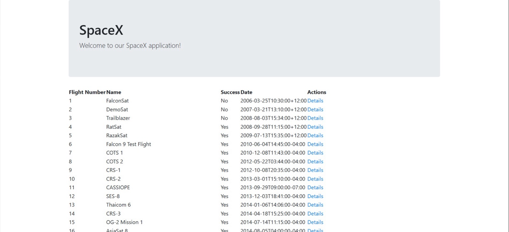

<div align="center">

# 🚀 SpaceX Launches

A React app that lists past SpaceX launches and their details from the SpaceX API.

<a href="https://github.com/miladmo68/SpaceX"></a>
<a href="https://miladweb.com"></a>

</div>

<p align="center">
  
</p>

## ✨ Features

- List of past launches
- Launch detail page
- React Router and styled-components

## 🛠️ Tech Stack

   

> [!NOTE]
> There is no hosted demo for this project. Run it locally with the steps below.

## 🚀 Getting Started

**Prerequisites:** [Node.js](https://nodejs.org/) 18 or newer

**Install and run**

```bash
git clone https://github.com/miladmo68/SpaceX.git
cd SpaceX
npm install
npm start
```

## 📁 Project Structure

```
SpaceX/
├── public/
├── src/
└── package.json
```

## 👤 Author

**Milad Mohammadi** — Frontend-Focused Full-Stack Developer, Toronto 🇨🇦

[](https://miladweb.com)
[](https://www.linkedin.com/in/miladmo68/)
[](https://github.com/miladmo68)

<p align="center"><sub>If you like this project, consider giving it a ⭐</sub></p>
